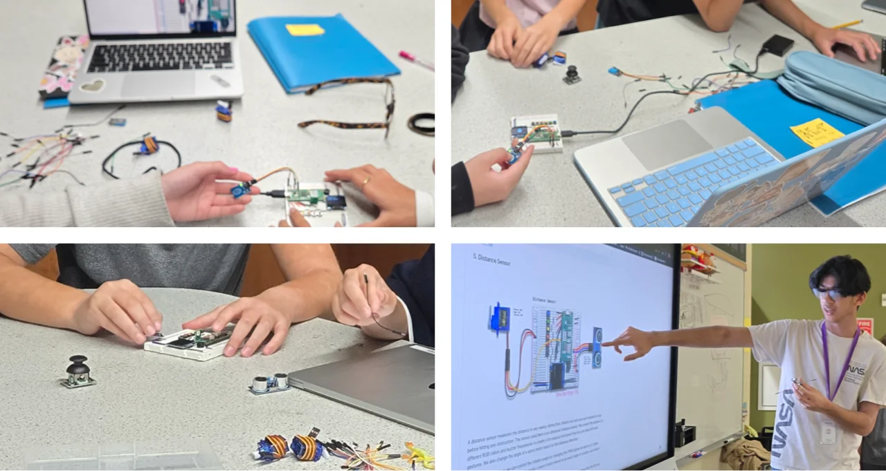
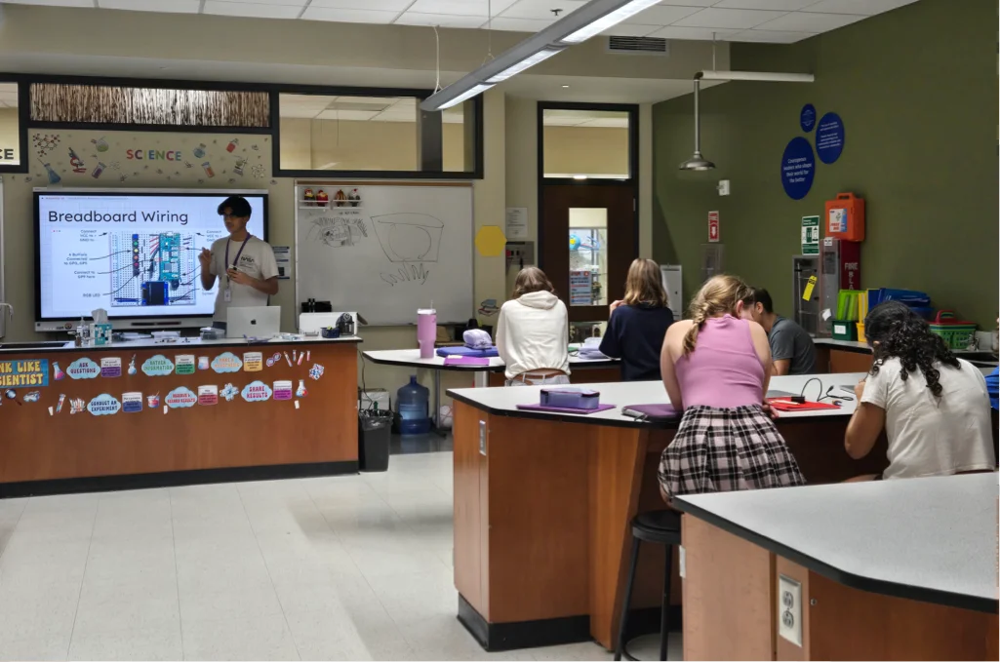
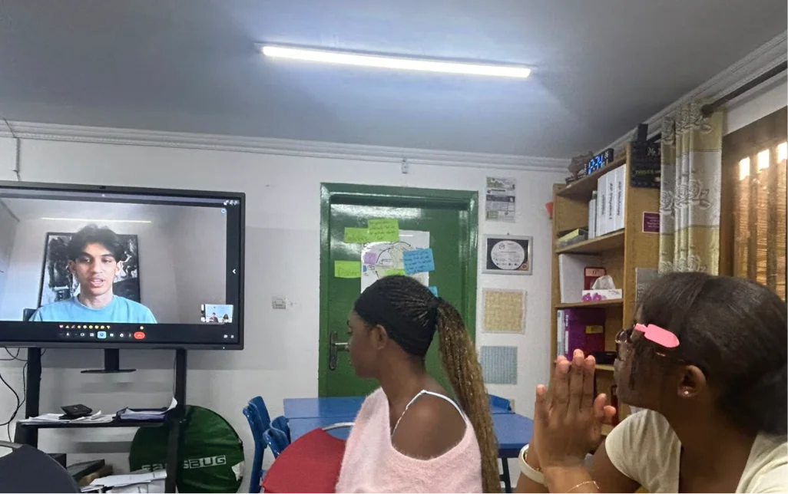

{: .fs-7.fw-300.mt-6,.mb-6.brand-color }
# Inventor Pi is a student-led STEM initiative focused on making hands-on invention more accessible for teachers and students. The goal is to help students move from simply learning about technology to actually building technology that solve real problems.

*Introduction to Electronics Workshop*
{: .caption }

Inventor Pi gives teachers and students a clear starting point to develop their skills with beginner-friendly Raspberry Pi Pico and electronics kits, lesson plan that teachers can use to create virtual and in-person workshops. It is targeted towards middle school and primary school teachers and students who want to introduce and learn hands-on STEM. 

{: .highlight.fs-7.fw-300 }
With the right guidance, everyone can learn electronics, AI, and computer vision through projects that connect to real-world impact.



Students learn basic electronic skills about using a breadboard, connecting sensors, motors and controllers, and programming on Raspberry Pi. With an early start, this can unlock their creativity and set them on their path to prototype new ideas, identify real world problems, and continue learning new skills, experimenting and inventing.

{: .highlight.quote }
>It was truly great to have Utshaho in class. He was fantastic with the kids, coming prepared with all the necessary materials. He provided clear instructions and offered support to the students throughout their activities. The students were engaged and enjoyed what they were doing. They were really interested in building different sensors.
>
>Ms. Irem Nekay\
>MYP Science Teacher\
>Atlanta International School

{: .highlight.quote.mt-6 }
>Just amazing! How Utshaho spoke to everyone in the room. He remembered everyone’s name. I wanted my students to learn about just giving back without expecting anything. They were so surprised. I am so grateful.
>
>Mr. Kevin Onabiyi\
>Director\
>American International School of Conakry

*Introduction to Electronics Workshop at Atlanta International School*
{: .caption.mt-6 }

*Inventor Pi introduction call with students and teachers at the American International School, Conakry, Guinea*
{: .caption.mt-6 }

{: .highlight.quote.mt-6 }
>I liked how many different things we could do, there was lots of variety.
>
>Grade 7 Student

{: .highlight.quote.short.mt-6 }
>. . . loved this lesson
>
>Grade 7 Student
