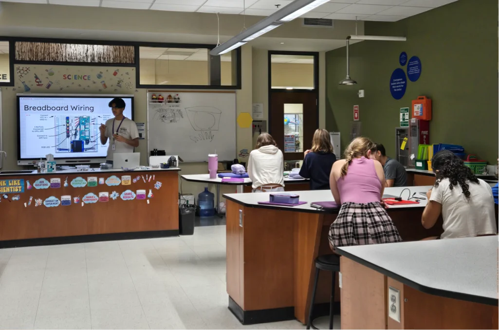
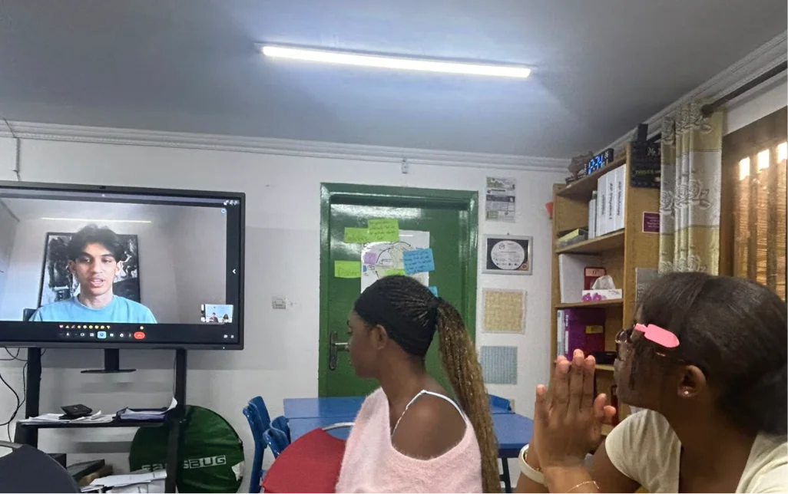

# Reaching Teachers and Students Worldwide


*Showing cities with active workshops/outreach, as well as cities in early stages of planning*
{: .caption }

{: .highlight.quote }
>It was truly great to have Utshaho in class. He was fantastic with the kids, coming prepared with all the necessary materials. He provided clear instructions and offered support to the students throughout their activities. The students were engaged and enjoyed what they were doing. They were really interested in building different sensors.
>
>Ms. Irem Nekay\
>MYP Science Teacher\
>Atlanta International School

{: .highlight.quote.mt-6 }
>Just amazing! How Utshaho spoke to everyone in the room. He remembered everyone’s name. I wanted my students to learn about just giving back without expecting anything. They were so surprised. I am so grateful.
>
>Mr. Kevin Onabiyi\
>Director\
>American International School of Conakry

*Introduction to Electronics Workshop at Atlanta International School*
{: .caption.mt-6 }

*Inventor Pi introduction call with students and teachers at the American International School, Conakry, Guinea*
{: .caption.mt-6 }

{: .highlight.quote.mt-6 }
>I liked how many different things we could do, there was lots of variety.
>
>Grade 7 Student

{: .highlight.quote.short.mt-6 }
>. . . loved this lesson
>
>Grade 7 Student
